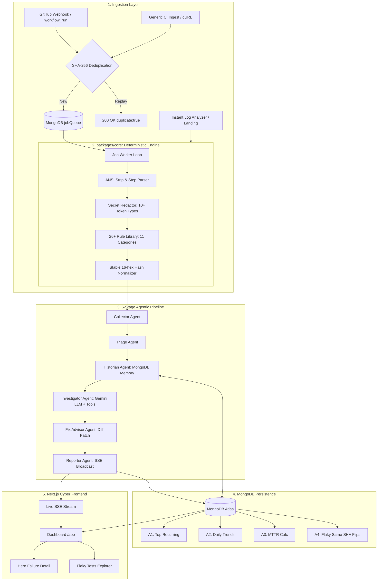

# Culprit — Agentic CI Failure Investigator

> **Built for UNCHARTED 2026** (Organised by NEXUS, DoCSE and DoAI Cell, SVNIT Surat in collaboration with MongoDB and n8n).  
> **Track 3:** Developer Tools for Production Use Cases.  
> **No Login Required for Judges:** Open the live URL and explore instant analysis or load the demo project with one click.

---

## ⚡ One-Line Pitch
*CI tells you that your build failed. Culprit tells you why, which commit probably did it, whether it has happened before, whether the test is just flaky, and what to do next.*

---

## 🏛️ System Architecture



---

## ✨ Key Features & Innovation Bar

1. **Zero-Login Instant Diagnosis:** Paste or drop any raw log on the landing page for immediate classification without creating an account or configuring tokens.
2. **Deterministic First, LLM Second:** 26+ deterministic rules across 11 categories establish factual categorization in <5ms. The LLM only explains, correlates, and advises.
3. **Automated Secret Redaction:** Redacts GitHub PATs, AWS keys, Google API keys, JWTs, Bearer tokens, and database passwords before anything is saved to MongoDB or sent to an LLM. Line numbers are strictly preserved.
4. **Stable Fingerprinting:** Volatile tokens (timestamps, PIDs, ephemeral ports, runner paths like `/home/runner/work/repo/repo/` -> `<WORKSPACE>/`) are normalized to guarantee identical failures yield identical 16-hex signatures.
5. **Interactive Agent Trace Timeline:** Visualizes the 6-stage pipeline (Collector -> Triage -> Historian -> Investigator -> Fix Advisor -> Reporter) with duration in milliseconds, status pills, and expandable tool calls.
6. **Suspect Commits Ranking:** Scores commits between the last green run and the failing run (+3 points for stack trace file match, +2 for lockfile/config, +1 for same directory) with plain-English rationales.
7. **Flaky vs. Broken Test Math:** Evaluates a 30-run sliding window per test. Tests with **same-SHA flips** (the identical commit both passed and failed) are mathematically flagged as flaky, accompanied by quarantine suggestions.
8. **Team Memory & Known Fixes:** Allows engineers to record fix notes against a signature. When that failure recurs weeks later on any branch, Culprit warns: *"Last time this was fixed by Alex: Type SessionUser was refactored."*
9. **Zero-LLM Fallback:** If the Gemini API key is missing or quotas are exhausted, Culprit automatically falls back to rule-based explanations (`source: "rules"`).

---

## 🍃 MongoDB Architecture & Best Practices

Culprit uses the **official MongoDB Node.js driver** (zero Mongoose bloat):

| Collection | Role | Unique & Compound Indexes |
|---|---|---|
| `projects` | Registered repositories & tokens | Unique `{ "repo.owner": 1, "repo.name": 1 }`, indexed on `ingestToken` |
| `runs` | Workflow run records | Unique `{ projectId: 1, runId: 1 }`, `{ projectId: 1, startedAt: -1 }` |
| `failures` | Individual step failures | `{ projectId: 1, createdAt: -1 }`, `{ projectId: 1, signature: 1 }`, `{ runId: 1 }` |
| `signatures` | Normalized failure signatures & memory | Unique `{ projectId: 1, signature: 1 }`, `{ projectId: 1, lastSeenAt: -1 }` |
| `testResults` | Test execution outcomes | Unique `{ eventId: 1 }`, `{ projectId: 1, testId: 1, ts: -1 }` |
| `diagnoses` | Agent root causes & diff patches | `{ failureId: 1, version: -1 }` |
| `agentSteps` | Step-by-step agent execution timeline | `{ failureId: 1, seq: 1 }` |
| `logs` | Chunked redacted raw logs | Compound `{ runId: 1, jobName: 1, chunkIndex: 1 }`, **TTL index on `createdAt` (14 days)** |
| `ingestEvents` | Ingestion deduplication store | Unique `{ eventId: 1 }` |
| `jobQueue` | In-process atomic task queue | Compound `{ status: 1, runAfter: 1 }` |

### Aggregation Pipelines Implemented
- **A1: Top Recurring Failures:** 7-day grouping by signature with `$lookup` to `signatures` for known fixes and statuses.
- **A2: Daily Trends by Category:** Daily breakdown of error categories powering the dashboard chart.
- **A3: MTTR per Signature:** Computes the average duration from first failure to subsequent green run.
- **A4: Flaky Test Math:** Computes same-commit outcome flips using `$addToSet` of outcomes per `{ testId, headSha }`.
- **Change Streams:** Watches `failures` and pushes realtime notifications to the dashboard via Server-Sent Events (`/api/stream`).

---

## 🚀 Quickstart Guide

### 1. Clone & Install
```bash
git clone https://github.com/culprit-ci/culprit.git
cd culprit
npm install
```

### 2. Configure Environment (.env)
```bash
cp .env.example .env
```
Fill in your MongoDB URI and Gemini API key:
```env
MONGODB_URI=mongodb+srv://...
GEMINI_API_KEY=your_gemini_api_key
PORT=4000
NEXT_PUBLIC_API_URL=http://localhost:4000
```

### 3. Run Locally
```bash
# Terminal 1: Start API server
npm --workspace=apps/api run dev

# Terminal 2: Start Next.js frontend
npm --workspace=apps/web run dev
```
Open [http://localhost:3000](http://localhost:3000) in your browser.

### 4. Run Automated Unit Tests
```bash
# Runs 28 unit tests across rules, redactor, fingerprinting, and flake math
npm run test
```

---

## 🔗 Connecting a GitHub Repository (5 Steps)

1. Open **Culprit Dashboard → Projects & Setup** (`/app/projects`).
2. Copy your unique **Webhook URL** and **Webhook Secret**.
3. In your GitHub repository, go to **Settings → Webhooks → Add webhook**.
4. Set **Payload URL** to your Culprit Webhook URL, **Content type** to `application/json`, and paste your secret.
5. Select **Workflow runs** under individual events and save. Every completed GitHub Actions run is now automatically ingested and investigated!

---

## 📡 Generic Ingest (cURL Example)

Any CI system (GitLab CI, Jenkins, CircleCI) can send failure telemetry:

```bash
curl -X POST "http://localhost:4000/api/ingest/demo-shop" \
  -H "Authorization: Bearer clp_demo_token_xyz" \
  -H "Content-Type: application/json" \
  -d '{
    "run": {
      "externalId": "build-892",
      "branch": "main",
      "sha": "9f8e7d6",
      "workflow": "Production Build",
      "status": "failure"
    },
    "log": "npm ERR! npm ci can only install packages when your package.json and package-lock.json are in sync."
  }'
```

---

## 📚 Documentation Links
- [System Architecture & Specifications](file:///d:/Uncharted/docs/ARCHITECTURE.md)
- [Judge Q&A Cheat Sheet (15 Key Questions)](file:///d:/Uncharted/docs/QNA.md)
- [7-Minute Demo Video Script](file:///d:/Uncharted/docs/DEMO_SCRIPT.md)

---

## ⚖️ Attributions
- Icons: [Lucide React](https://lucide.dev)
- Charts: [Recharts](https://recharts.org)
- XML Parser: [fast-xml-parser](https://github.com/NaturalIntelligence/fast-xml-parser)
- CSS Utility: [Tailwind CSS](https://tailwindcss.com)
- Database Driver: [Official MongoDB Node.js Driver](https://www.mongodb.com/docs/drivers/node/current/)
- AI Foundation: [Google Gemini](https://ai.google.dev) (`gemini-2.5-flash`)

---

## 👥 UNCHARTED 2026 Team
Built with passion for Track 3: Developer Tools for Production Use Cases.
