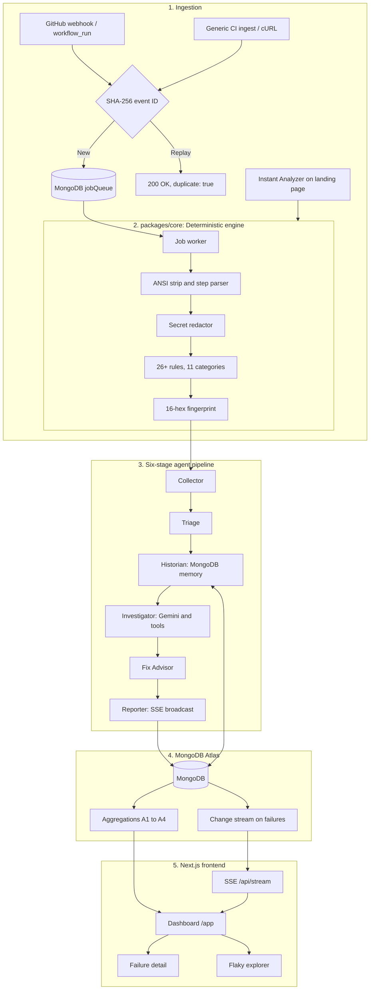

# Origin: Agentic CI Failure Investigator

> **Built for UNCHARTED 2026** (NEXUS, DoCSE & DoAI Cell, SVNIT Surat, in collaboration with MongoDB and n8n)
> **Track 3: Developer Tools for Production Use Cases**
> **Team KeyQuest:** Komudi Ekatpure, Aesha Shingala, Hema Akshita

**Live app:** https://uncharted-gamma.vercel.app (no login needed)
**Repository:** https://github.com/Komeka71/Uncharted

*CI tells you that your build failed. Origin tells you why, which commit probably caused it, whether it has happened before, whether the test is flaky, and what to do next.*

---

## Table of Contents

1. [The Problem](#1-the-problem)
2. [Our Solution](#2-our-solution)
3. [Try It in 2 Minutes (For Judges)](#3-try-it-in-2-minutes-for-judges)
4. [Key Features](#4-key-features)
5. [System Architecture](#5-system-architecture)
6. [How an Investigation Works](#6-how-an-investigation-works)
7. [Deterministic Engine](#7-deterministic-engine)
8. [Historical Intelligence](#8-historical-intelligence)
9. [MongoDB Usage](#9-mongodb-usage)
10. [API Reference](#10-api-reference)
11. [Tech Stack](#11-tech-stack)
12. [Project Structure](#12-project-structure)
13. [Quickstart (Run Locally)](#13-quickstart-run-locally)
14. [Connect Your Own Repository](#14-connect-your-own-repository)
15. [Testing](#15-testing)
16. [How Origin Maps to the Judging Criteria](#16-how-origin-maps-to-the-judging-criteria)
17. [Limitations and Roadmap](#17-limitations-and-roadmap)
18. [Documentation](#18-documentation)
19. [Team and Attributions](#19-team-and-attributions)

---

## 1. The Problem

When a CI build fails, the developer gets a wall of text. The real cause is one line inside hundreds or thousands of lines. This creates four everyday problems:

| Problem | What happens today |
|---|---|
| **The cause is buried** | Developers scroll through logs and guess which line matters. |
| **Old failures come back** | The fix lives in someone's head or a chat thread, not next to the failure. |
| **Flaky or broken?** | Without history, teams re-run the job and hope it turns green. |
| **Logs leak secrets** | Tokens printed in CI output can be stored, shared, or pasted into an LLM prompt. |

The result: developers spend their time **diagnosing** failures instead of **fixing** them.

## 2. Our Solution

Origin investigates every failed CI run and answers five questions:

| # | Question | How Origin answers it |
|---|---|---|
| 1 | **Why did it fail?** | A rule-based category, with evidence lines cited from the log. |
| 2 | **Which commit caused it?** | Suspect commits are ranked, each with a plain-English reason. |
| 3 | **Have we seen it before?** | A stable fingerprint recalls earlier runs and any recorded fix. |
| 4 | **Is it flaky or broken?** | A 30-run window detects same-commit pass/fail flips. |
| 5 | **How do we fix it?** | Team-recorded fixes, ordered steps, and a suggested patch. |

**Design principle: rules decide facts, AI explains.** The LLM never decides whether a build failed or what category the failure belongs to. Deterministic rules do that first. The LLM only explains, correlates history, and suggests a fix, and its cited evidence is validated against the real log.

## 3. Try It in 2 Minutes (For Judges)

No login or setup is needed.

1. Open **https://uncharted-gamma.vercel.app**.
2. **Instant Analyzer:** click **Analyze a log now**, load a sample (for example *npm Lockfile Mismatch*), and click **Diagnose Log Now**. You get the failure category, cited log lines, and redacted secrets.
3. Click **Launch live demo** (opens `/app`). If the dashboard is empty, click **Seed Demo** to load a demo project with sample runs and history.
4. Open any failure to see the **Root Cause**, **Suspect Commits**, suggested patch, and the **Agent Trace** tab.
5. Open **Flaky Tests** (`/app/flaky`) to see the flaky vs broken verdicts.
6. Use **Simulate Run...** to trigger a new failing run and watch it appear live.
7. Open **Project Settings** (`/app/projects`) to see the GitHub webhook and cURL setup.

## 4. Key Features

1. **Zero-login instant diagnosis.** Paste any raw CI log on the landing page and get a classification immediately.
2. **Deterministic first, LLM second.** 26+ rules across 11 categories establish the facts before any AI is involved.
3. **Secret redaction before storage and before the LLM.** GitHub tokens, AWS keys, Google API keys, JWTs, bearer tokens and database credentials are masked. Line numbers are preserved so citations stay correct.
4. **Stable failure fingerprints.** Volatile parts (timestamps, process IDs, ports, runner paths) are normalized so the same failure always produces the same 16-character signature.
5. **Six-stage agent pipeline with a visible trace.** Every stage shows its status, duration in milliseconds, and tool calls.
6. **Explainable suspect-commit ranking.** Each score comes with a human-readable reason.
7. **Flaky vs broken detection.** A 30-run sliding window and same-commit flips decide the verdict. Too little data is reported as *Watch*, not guessed.
8. **Team memory with fix status.** Fixes recorded against a signature resurface when the failure recurs. A note is not treated as confirmed until later runs support it.
9. **Zero-LLM fallback.** If the Gemini key is missing or quota is exhausted, Origin returns a rule-based diagnosis automatically (`source: "rules"`).
10. **Live updates.** A MongoDB change stream feeds Server-Sent Events so new failures appear on the dashboard in real time.

## 5. System Architecture



## 6. How an Investigation Works

| Stage | Agent | What it does | Uses |
|---|---|---|---|
| 1 | **Collector** | Pulls logs, jobs, and commit compare data. | GitHub API / ingest payload |
| 2 | **Triage** | Cleans the log, redacts secrets, applies rules, fingerprints the failure. | Deterministic code |
| 3 | **Historian** | Finds earlier runs, regression status, and known fixes. | MongoDB |
| 4 | **Investigator** | Reasons over the evidence with tools. Cited lines are validated. | Gemini |
| 5 | **Fix Advisor** | Produces ordered steps, a verify command, and a suggested diff. | Gemini |
| 6 | **Reporter** | Saves the diagnosis and trace, then broadcasts a live event. | MongoDB, SSE |

**Guardrails on the AI**

- **Redact first:** secrets become `[REDACTED:type]` before storage or any prompt.
- **Small, numbered context:** Gemini only sees a redacted window around the failing step, with 1-indexed line numbers.
- **Citations are checked:** evidence lines that do not exist in the log are dropped.
- **Never goes down:** a missing key, timeout, or quota error falls back to rule-based output.

## 7. Deterministic Engine

Located in `packages/core`, with no database or network dependency, so it can be tested with saved log samples alone.

- **Log cleaner:** strips ANSI codes, normalizes timestamps, and parses CI step boundaries.
- **Secret redactor:** multi-pattern masking for GitHub PATs, AWS keys, Google API keys, JWTs, bearer tokens, and database connection strings.
- **Rule library:** 26+ rules grouped into 11 categories.

| Category | Example failure |
|---|---|
| `dependency` | npm lockfile out of sync, missing package |
| `build_compile` | TypeScript or compiler errors |
| `test_failure` | assertion failures |
| `config_env` | missing environment variable |
| `permissions_secrets` | denied access, missing secret |
| `docker_container` | image or container errors |
| `infra_runner` | runner or disk problems |
| `lint_format` | lint and formatting errors |
| `network_transient` | socket reset, temporary network error |
| `timeout` | step or test timeout |
| `unknown` | no rule matched (never given an invented cause) |

- **Fingerprint:** `sha1(ruleId | normalized line | category)`, shortened to 16 hex characters. For example, `/home/runner/work/app/app/src/a.ts` becomes `<WORKSPACE>/src/a.ts` before hashing, so the same failure on different runners gets the same signature.

## 8. Historical Intelligence

**Suspect commits.** Commits between the last green run and the failing run are scored:

| Points | Reason |
|---|---|
| +3 | Touched a file cited in the failure |
| +2 | Changed a lockfile or CI configuration |
| +1 | Edited the same directory |

The top suspects are shown with their reasons. With no commit data, Origin reports insufficient data instead of guessing.

**Flaky vs broken.** Each test is judged over a 30-run sliding window.

| Verdict | Meaning |
|---|---|
| **Stable** | Passes every run in the window |
| **Watch** | Fewer than 5 runs, not enough evidence |
| **Flaky** | The same commit both passed and failed (a same-SHA flip). A quarantine suggestion is shown. |
| **Broken** | Fails consistently since a specific commit |

**Team memory.** An engineer can record a fix against a failure signature. When that failure returns, the page shows a **REGRESSION DETECTED** badge and the earlier fix note. A fix is treated as unverified until a later run supports it.

## 9. MongoDB Usage

Origin uses the official MongoDB Node.js driver (no ODM).

| Collection | Role | Key indexes |
|---|---|---|
| `projects` | Registered repositories and ingest tokens | Unique `{repo.owner, repo.name}`, index on `ingestToken` |
| `runs` | Workflow run records | Unique `{projectId, runId}`, `{projectId, startedAt: -1}` |
| `failures` | Individual step failures | `{projectId, createdAt: -1}`, `{projectId, signature}`, `{runId}` |
| `signatures` | Normalized signatures and team memory | Unique `{projectId, signature}`, `{projectId, lastSeenAt: -1}` |
| `testResults` | Test outcomes | Unique `{eventId}`, `{projectId, testId, ts: -1}` |
| `diagnoses` | Root causes and patches | `{failureId, version: -1}` |
| `agentSteps` | Agent execution timeline | `{failureId, seq}` |
| `logs` | Chunked, redacted raw logs | `{runId, jobName, chunkIndex}`, **TTL on `createdAt` (14 days)** |
| `ingestEvents` | Deduplication store | Unique `{eventId}` |
| `jobQueue` | Task queue | `{status, runAfter}` |

**Features used**

- **Unique indexes + SHA-256 event IDs:** a replayed webhook is rejected and returns `duplicate: true`.
- **Schema validation:** `$jsonSchema` validators guard required fields on key collections.
- **Aggregation pipelines:**
  - **A1:** top recurring failures over 7 days, with `$lookup` to known fixes
  - **A2:** daily failure trends by category
  - **A3:** mean time to recovery per signature
  - **A4:** same-commit outcome flips for flaky tests
- **TTL index:** redacted logs expire after 14 days.
- **Change streams:** a watch on `failures` pushes live events to the dashboard over SSE (`/api/stream`).

## 10. API Reference

Base URL: `http://localhost:4000` locally.

| Method | Endpoint | Purpose |
|---|---|---|
| GET | `/health` | Health check |
| POST | `/api/analyze` | Instant analysis of a pasted log (no login) |
| POST | `/api/webhooks/github` | GitHub `workflow_run` webhook |
| POST | `/api/ingest/:projectId` | Generic CI ingest (bearer token) |
| GET | `/api/failures` | List failures |
| GET | `/api/failures/:id` | Failure detail with diagnosis, suspects, trace |
| POST | `/api/failures/:id/feedback` | Save feedback on a diagnosis |
| POST | `/api/failures/:id/reanalyze` | Re-run the investigation |
| POST | `/api/signatures/:signature/known-fix` | Record a fix note |
| GET | `/api/signatures/:signature/history` | Past occurrences of a signature |
| GET | `/api/flaky` | Flaky vs broken test verdicts |
| GET | `/api/stats/overview` | Dashboard statistics |
| GET | `/api/stream` | Live Server-Sent Events |
| GET / POST | `/api/projects`, `/api/projects/:id` | Project list and setup |
| POST | `/api/projects/:id/sync` | Sync recent GitHub runs |
| POST | `/api/demo/seed` | Seed the demo project |
| POST | `/api/demo/simulate/:scenario` | Simulate a failing run |
| POST | `/api/demo/reset` | Reset demo state |

## 11. Tech Stack

| Layer | Technology |
|---|---|
| Frontend | Next.js 14, React 18, Tailwind CSS, Recharts, Lucide icons |
| API | Node.js, Express, TypeScript, Zod, Helmet |
| Core engine | TypeScript package (`packages/core`) |
| Database | MongoDB Atlas, official Node.js driver |
| AI | Google Gemini (`gemini-2.5-flash`) with rule-based fallback |
| CI integrations | GitHub Actions webhooks (HMAC-SHA256), generic ingest |
| Deployment | Vercel (frontend) |

## 12. Project Structure

```
Uncharted/
├── apps/
│   ├── api/                # Express API
│   │   └── src/
│   │       ├── routes/         # analyze, ingest, webhooks, failures, flaky, stats, stream, demo...
│   │       ├── services/       # agentOrchestrator, gemini, github, sse
│   │       ├── aggregations/   # MongoDB pipelines A1 to A4
│   │       ├── history/        # historian service
│   │       ├── queue/          # job queue
│   │       └── db/             # client, schema validators, indexes
│   └── web/                # Next.js frontend
│       └── app/                # landing page, /app, /app/failures/[id], /app/flaky, /app/projects
├── packages/core/          # Deterministic engine: cleaner, redactor, rules, fingerprint, suspect, flake
├── docs/                   # Architecture, contracts, judge Q&A, demo script
├── .env.example
└── package.json            # npm workspaces
```

## 13. Quickstart (Run Locally)

**Requirements:** Node.js 18+ and a MongoDB database (Atlas or a local replica set; change streams need a replica set). A Gemini API key is optional.

```bash
# 1. Clone and install
git clone https://github.com/Komeka71/Uncharted.git
cd Uncharted
npm install

# 2. Configure
cp .env.example .env
# edit .env with your values

# 3. Start the API (terminal 1)
npm run dev:api

# 4. Start the web app (terminal 2)
npm run dev:web
```

Open http://localhost:3000. Click **Seed Demo** on the dashboard to load sample data.

**Environment variables**

| Variable | Required | Description |
|---|---|---|
| `MONGODB_URI` | Yes | MongoDB connection string |
| `GEMINI_API_KEY` | No | Enables AI explanations. Without it, Origin uses rule-based fallback. |
| `LLM_MODEL` | No | Defaults to `gemini-2.5-flash` |
| `PORT` | No | API port, default `4000` |
| `CORS_ORIGIN` | No | Allowed web origin, default `http://localhost:3000` |
| `PUBLIC_API_URL` | No | Public API URL, used to build webhook URLs |
| `GITHUB_TOKEN` | No | Token with Actions read scope, for syncing GitHub runs |
| `N8N_WEBHOOK_URL` | No | Reserved for the n8n integration (see roadmap) |
| `NEXT_PUBLIC_API_URL` | Yes (web) | API URL used by the frontend |

> Never commit your `.env` file or real API keys.

## 14. Connect Your Own Repository

**GitHub Actions (webhook)**

1. Open **Project Settings** (`/app/projects`) and copy the **Webhook URL** and **Webhook Secret**.
2. In your GitHub repository, go to **Settings → Webhooks → Add webhook**.
3. Paste the Webhook URL as the **Payload URL**, set **Content type** to `application/json`, and paste the secret.
4. Under individual events, select **Workflow runs** and save.

Every completed workflow run is now ingested and investigated.

**Any other CI (GitLab, Jenkins, CircleCI): generic ingest**

```bash
curl -X POST "http://localhost:4000/api/ingest/demo-shop" \
  -H "Authorization: Bearer <your-ingest-token>" \
  -H "Content-Type: application/json" \
  -d '{
    "run": {
      "externalId": "build-892",
      "branch": "main",
      "sha": "9f8e7d6",
      "workflow": "Production Build",
      "status": "failure"
    },
    "log": "npm ERR! npm ci can only install packages when your package.json and package-lock.json are in sync."
  }'
```

## 15. Testing

```bash
npm test          # runs the packages/core test suite
npm run check     # TypeScript type checks for core, api, and web
```

The core tests cover the cleaner, redactor, parsers, rule engine, fingerprinting, suspect-commit scoring, flaky-test math, and signature history. The API includes tests for Gemini response handling. The deterministic engine runs without MongoDB, Gemini, or the dashboard.

## 16. How Origin Maps to the Judging Criteria

| Criterion | Where to see it |
|---|---|
| **Innovation and originality** | Deterministic-first design, validated AI citations, explainable commit ranking, team memory with fix status |
| **Technical implementation** | Six-stage pipeline, monorepo with an independently testable core, MongoDB indexes, aggregations, change streams |
| **Functionality and deployment** | Live URL with zero login, one-click demo seed, simulated failing runs, working GitHub webhook and generic ingest |
| **Problem relevance and impact** | Faster triage, fewer repeat failures, safer logs (see sections 1 and 2) |
| **Demo and documentation** | This README, `docs/` folder, and the demo video |

**Track 3 requirements:** run history stored with stable IDs and timestamps, indexes for common questions, aggregation pipelines for comparisons, schema validation on events, change streams for live views, and safe repeated ingestion through unique event IDs.

## 17. Limitations and Roadmap

Honest notes on the current version:

- The job queue runs inside the API process, not in a separate worker service.
- Gemini is optional. Without it, diagnoses come from rules only, with less natural explanations.
- The suggested patch is advice for a developer to review. Origin does **not** modify code or run commands on its own.
- GitHub Actions has native support. Other CI systems use the generic ingest endpoint.
- **n8n is not integrated yet.** The environment variable `N8N_WEBHOOK_URL` is reserved for it.

**Next steps**

| Item | Description |
|---|---|
| **n8n alerts** | A workflow that receives "investigation completed" and posts the diagnosis summary and dashboard link to Slack or Discord, with error handling and execution logs |
| **PR comments** | Post the diagnosis back on the pull request |
| **More CI adapters** | Native GitLab and Jenkins parsers |
| **More rule packs** | More languages and build tools |

## 18. Documentation

- [System Architecture](docs/ARCHITECTURE.md)
- [Analyzer contract](docs/analyzer-contract.md)
- [History contract](docs/history-contract.md)
- [Judge Q&A](docs/QNA.md)
- [Demo video script](docs/DEMO_SCRIPT.md)

## 19. Team and Attributions

**Team KeyQuest:** Komudi Ekatpure, Aesha Shingala, Hema Akshita, SVNIT Surat.

- Icons: [Lucide](https://lucide.dev)
- Charts: [Recharts](https://recharts.org)
- Styling: [Tailwind CSS](https://tailwindcss.com)
- XML parsing: [fast-xml-parser](https://github.com/NaturalIntelligence/fast-xml-parser)
- Database driver: [MongoDB Node.js Driver](https://www.mongodb.com/docs/drivers/node/current/)
- AI: [Google Gemini](https://ai.google.dev)